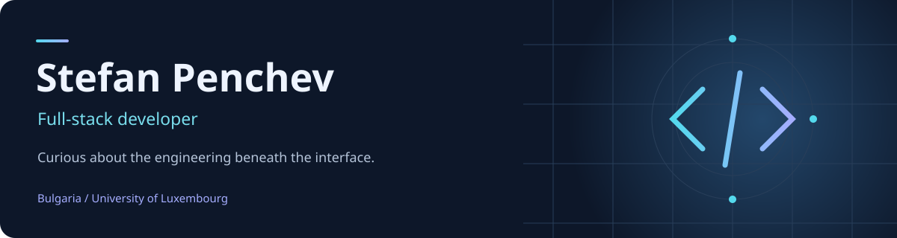
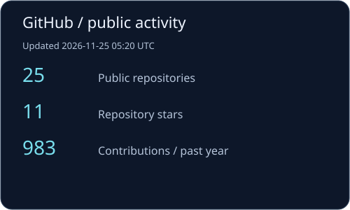
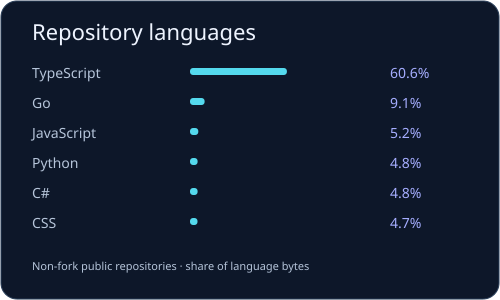

  

<h3 align="center">Full-Stack & Systems Software Engineer · Computer Science Student</h3>

  <a href="https://www.linkedin.com/in/stefan-penchev-31b94a318/">LinkedIn</a> · 
  <a href="https://github.com/StefanPenchev05">GitHub</a> · 
  <a href="mailto:your.email@example.com">Email</a>

---

### About

I am a Computer Science student at the **University of Luxembourg** (originally from Bulgaria) focused on full-stack web development, backend architecture, and applied AI systems. I enjoy building end-to-end software products with a strong emphasis on security, clean domain boundaries, and understanding the underlying infrastructure.

* **Currently building:** Production-grade authentication and recruitment workflows in **Rust** and **Angular**, alongside local-first AI tooling for financial compliance and auditing.
* **Exploring:** Distributed systems, cloud-native deployments (Docker, Kubernetes, AWS), and systems programming in Rust, C++, and Go.
* **Interests:** Mathematics, cyber-physical systems, and playing guitar.

---

### Technical Stack

| Domain | Technologies |
| :--- | :--- |
| **Languages** | Rust, TypeScript, JavaScript (ES6+), Python, Go, C++, SQL |
| **Frontend** | Angular, React, Next.js, Tailwind CSS, HTML5/CSS3 |
| **Backend & Data** | Axum, FastAPI, Node.js, Express, PostgreSQL (`pgvector`), Redis, MongoDB, MySQL, MinIO |
| **Cloud & DevOps** | Docker, Docker Compose, AWS, Linux, Bash, Git, CI/CD |
| **Security & Auth** | OAuth 2.0 / OIDC (PKCE, ES256), Argon2id, RBAC, Session & Token Security |
| **Testing & APIs** | SQLx, Jest, Vitest, Playwright, Cypress, REST, Swagger/OpenAPI |

---

### Selected Projects *(Private Repositories)*

* **DTO Recruitment Platform** — *Rust (Axum), Angular, PostgreSQL, Redis, Docker*
  Full-stack recruitment and candidate discovery monorepo built with clean domain/infrastructure separation. Engineered custom multi-role RBAC extractors, Argon2id password security, Google/Apple OAuth 2.0 (PKCE & ES256) with safe account linking, Redis-backed rate limiting, and durable background email workers via Redis Streams.

* **AuditCoreAI** — *Python (FastAPI), Next.js, PostgreSQL (`pgvector`), Ollama, MinIO*
  Private, local-first AI-assisted audit platform designed for secure financial document analysis and IT control testing. Combines deterministic rule execution against read-only client databases with locally hosted LLM inference to trace evidence, flag compliance exceptions, and draft human-reviewed audit findings without exposing sensitive data externally.

---

### GitHub Activity

  
  

