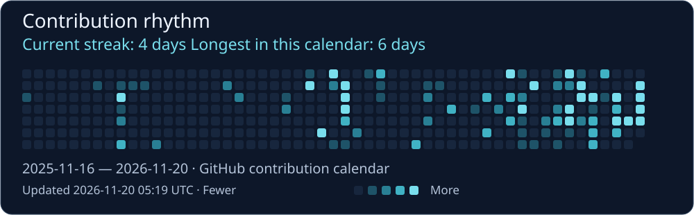
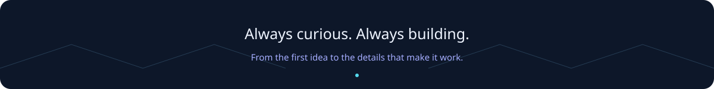

<p align="center">
  
  
</p>

<p align="center">
  <a href="https://www.linkedin.com/in/stefan-penchev-31b94a318/"></a>
  
  <a href="https://github.com/StefanPenchev05"></a>
  
</p>

<p align="center"><a href="#about-me">About</a> · <a href="#current-focus">Focus</a> · <a href="#tech-stack">Stack</a> · <a href="#github-stats">Activity</a></p>


<a name="about-me"></a>

## 👨‍💻 About Me

```typescript
const stefan = {
  name: "Stefan Penchev",
  from: "Bulgaria",
  studying: "Computer Science · University of Luxembourg",
  buildingWith: ["TypeScript", "JavaScript", "React", "Node.js"],
  exploring: ["C++", "Python", "Go", "AI & machine learning"],
  interests: ["Mathematics", "Systems", "Cyber-physical systems"],
  approach: "Build real software. Understand the principles beneath it.",
  awayFromKeyboard: "Playing guitar",
};
```


<a name="current-focus"></a>

## 🎯 Current Focus

<p align="center"><b>Building software. Deepening the foundations.</b><br />
Full-stack development alongside my computer science studies.</p>

<div align="center">
  
  <p><b>📚 The Book Next Door</b><br />
  <sub>A project from my development journey · Mobile application with a backend</sub><br />
  <sub>React Native · Node.js · MongoDB</sub></p>

### 🌱 Learning journey

<p><b>Exploring</b> · React Native, cloud infrastructure and DevOps<br />
<sub>AWS · Docker · Kubernetes</sub></p>
<p><b>Longer-term interests</b><br />
<sub>AI & machine learning · Systems programming · Robotics & cyber-physical systems</sub></p>
</div>


<a name="tech-stack"></a>

## 💼 Tech Stack

<p align="center">My development toolkit and technologies explored along the way.<br />
<sub>Icons represent tools, not proficiency ratings. Current learning is called out above.</sub></p>

<h3 align="center">Core Languages</h3>
<p align="center">
  
</p>

<h3 align="center">Frontend</h3>
<p align="center">
  
  
</p>

<h3 align="center">Backend & Databases</h3>
<p align="center">
  
  
</p>

<h3 align="center">DevOps & Tools</h3>
<p align="center">
  
  
</p>

<h3 align="center">Testing & Documentation</h3>
<p align="center">
  
  
  
  
  
  
</p>


<a name="github-stats"></a>

## 📊 GitHub Stats

<p align="center">
</p>
<p align="center"></p>
<p align="center"><sub>Generated from GitHub's API. Language usage describes repository code, not proficiency.<br />
Streaks count consecutive contribution days in GitHub's calendar; today's day may still be in progress.</sub></p>


## 🐍 Contribution Snake

<p align="center">
  <picture>
    <source media="(prefers-color-scheme: dark)" srcset="https://raw.githubusercontent.com/StefanPenchev05/StefanPenchev05/output/github-contribution-grid-snake-dark.svg" />
    
  </picture>
</p>


## 🏆 Achievements

<p align="center">
  <a href="https://github.com/StefanPenchev05?tab=achievements"></a><br />
  <sub>Explore the milestones behind the contributions.</sub>
</p>

<p align="center"></p>
